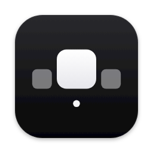

# Dockry

A dock for macOS that changes with what you're doing. Dockry runs next to the system Dock
(the way Raycast runs next to Spotlight) instead of modifying it. It can hide the system
Dock while it runs and gives it back when it quits.

| Work | Chill, with the Spotify widget |
|---|---|
| 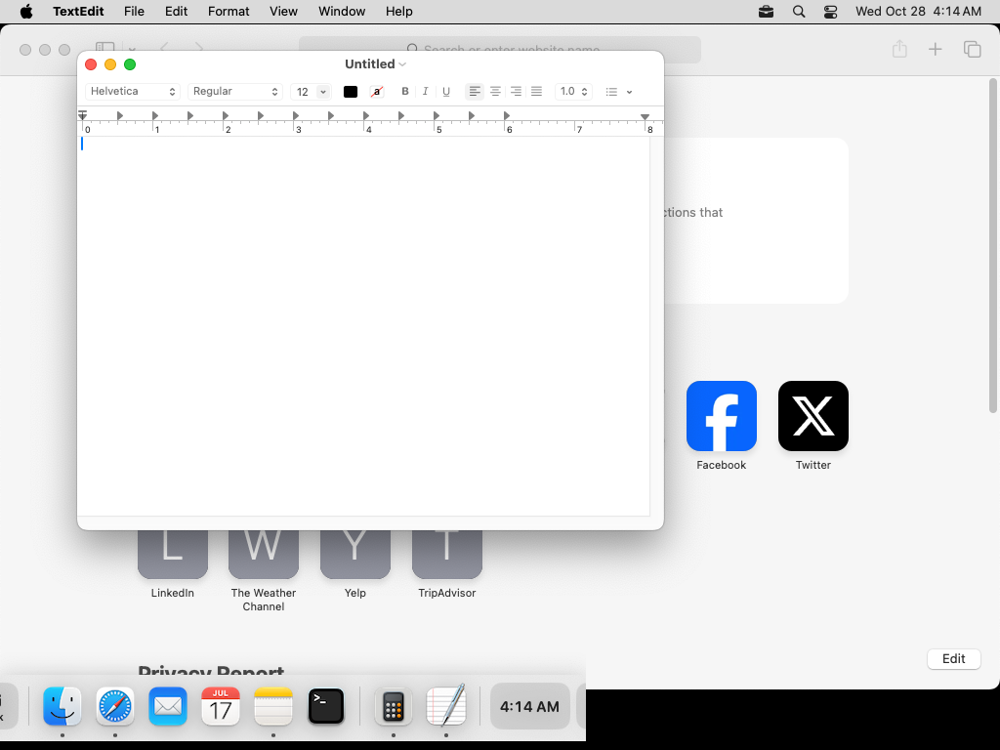 | 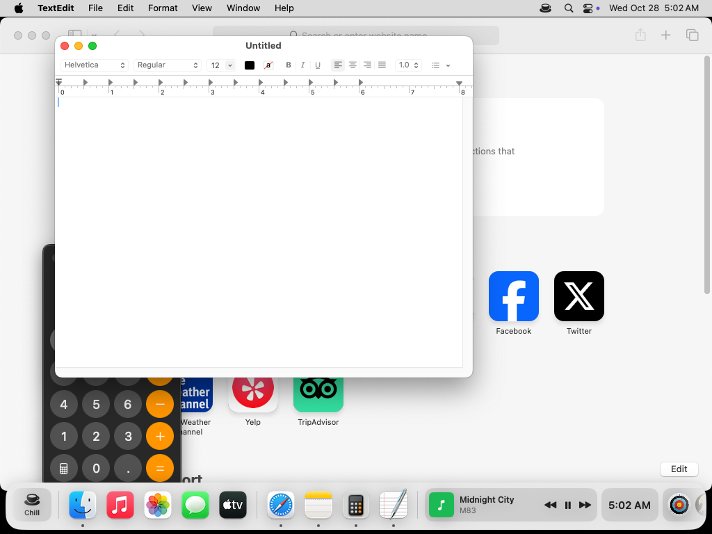 |
| **Magnification** | **On the left, smaller** |
| 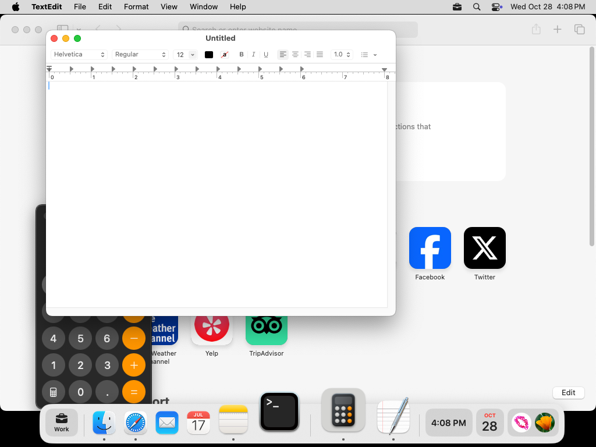 | 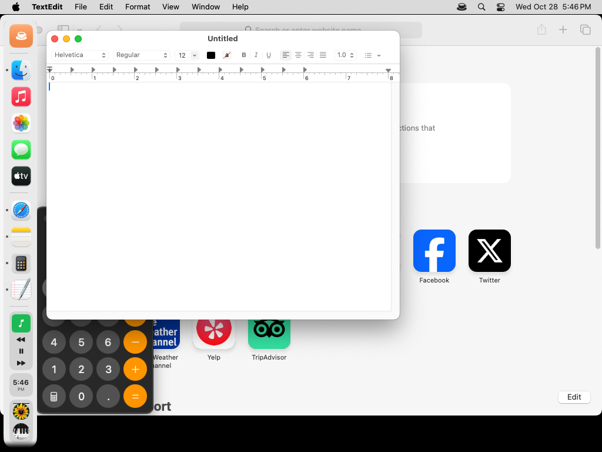 |
| **Spotify player and search** | **Calendar** |
| 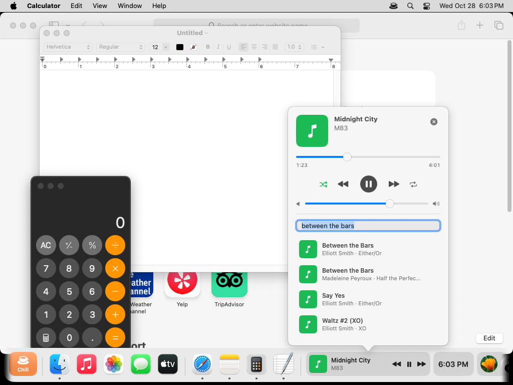 | 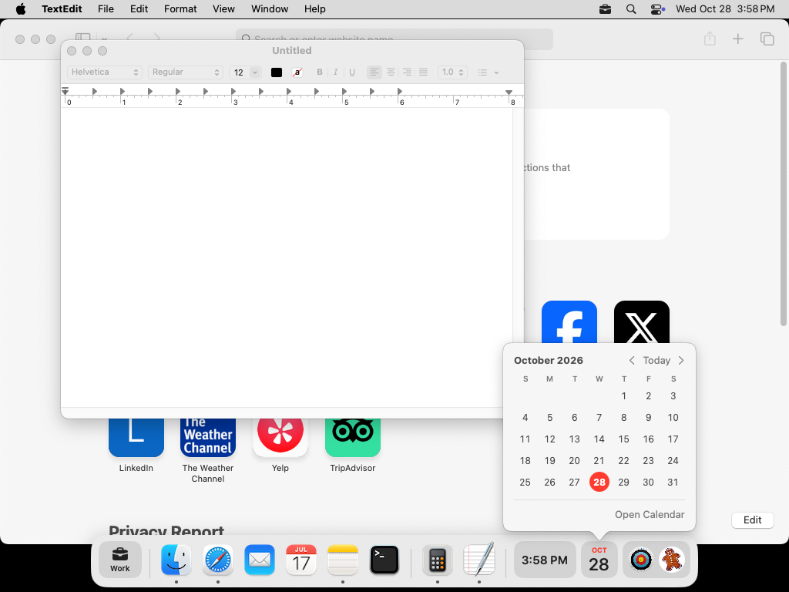 |
| **Settings** | **Profile editor** |
| 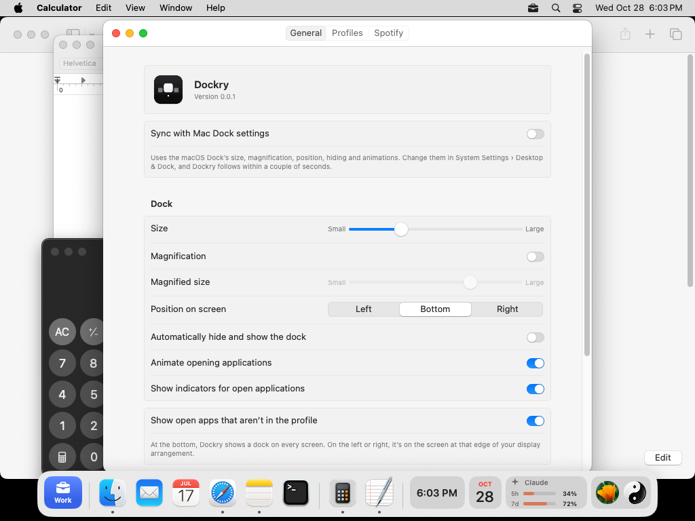 | 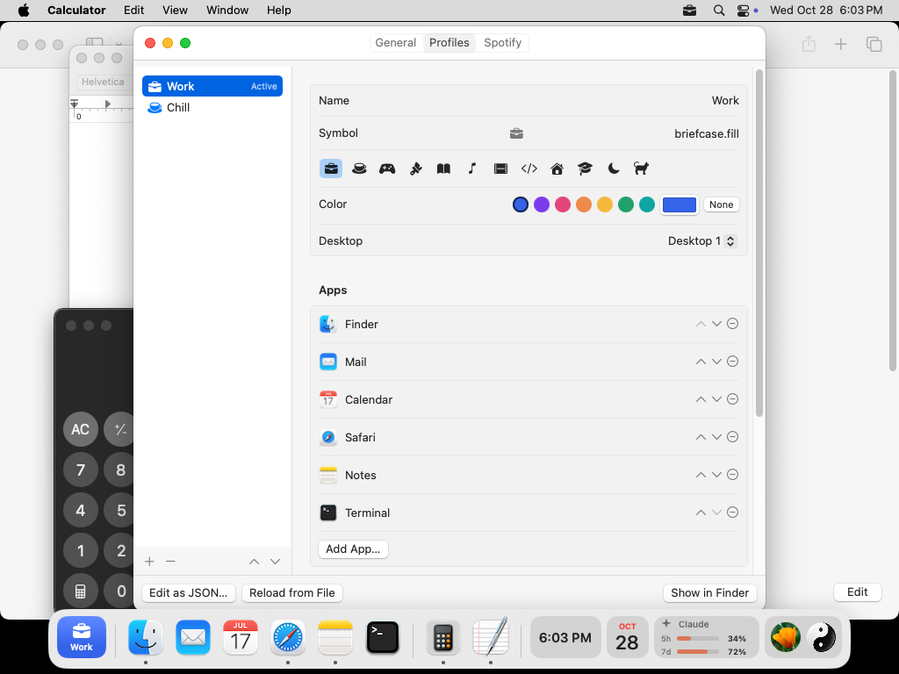 |
| **Profile switcher** | **Menu bar** |
| 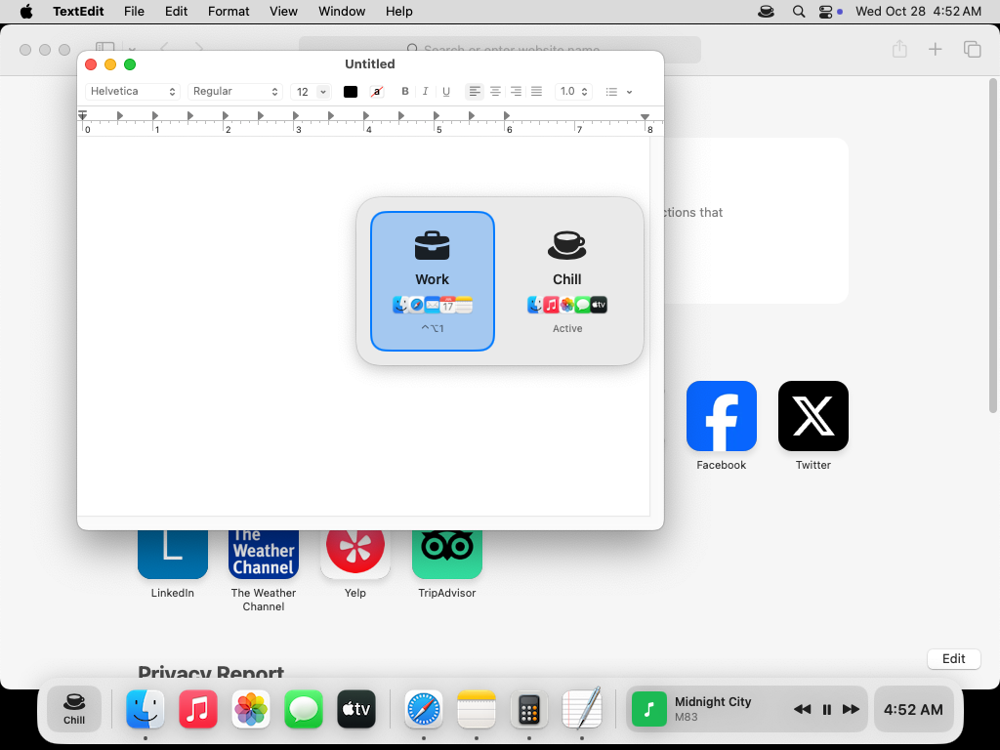 | 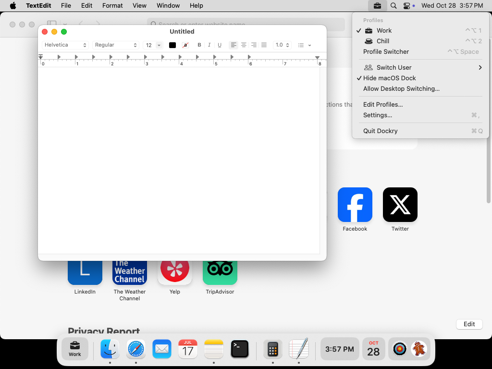 |
| **Widgets** | |
|  | |

The screenshots are taken on a GitHub-hosted macOS machine by the **Build & Screenshots**
workflow, which only runs when started from the Actions tab. On `dev` it commits them here;
feature branches (`dev-*`) publish theirs to the
[`screenshots`](https://github.com/juan-alvarz/Dockry/tree/screenshots) branch, one folder
per branch, so PRs into `dev` don't carry PNG changes that conflict with each other.
That machine has no Spotify, so CI sends the notification Spotify posts when a song starts
to show the widget with a track.

## What it does

- **A floating dock**, on every desktop. It shows the active profile's pinned apps, any
  other app that's running, and the profile's widgets, in whatever order you arrange them.
  Like the system Dock it's exactly as
  long as what's in it; if that would be longer than the screen, it scrolls instead.
  A dot marks running apps, and the hovered app shows its name. Click to open or switch to an
  app; an app that's launching bounces. Drag an app, a widget or a divider along the dock
  to give it a new place; the others make room as you drag. Dragging an open app that isn't
  in the profile keeps it there. Only the profile button stays first. Right-click an app to
  keep it in or remove it from the profile, show it in Finder, or quit it. Every right-click
  menu in the dock also has **Add Divider** and **Add Widget**, which add them right after
  what you clicked.
- **Works like the macOS Dock:** bottom, left or right of the screen; any size from 16 to 128
  points (drag a divider up or down to resize, as in the Dock); magnification; automatic hiding.
  Right-click the dock's background for the same quick menu the Dock has.
- **Keeps its space, like the macOS Dock:** windows stop at the dock's edge. A zoomed window
  fills the space above the dock, and a window dragged behind it moves back out when you let
  go. While the dock hides automatically it keeps no space, as with the Dock. macOS only
  lets its own Dock change the space it gives windows, so Dockry moves them through
  Accessibility instead (it asks for access); turn this off in Settings › General.
- **Every screen:** at the bottom, each screen gets a dock. On the left or right, only the
  screen at that edge of your display arrangement does: with the built-in display on the left
  and an external one on the right, a left dock is on the built-in display and a right dock
  on the external one.
- **Settings** (⌘, or the menu bar item): everything above, plus **Sync with Mac Dock
  settings**, which uses the macOS Dock's own size, magnification, position, hiding and
  animations and follows changes to them. Also **Hide macOS Dock** and **Open at login**.
- **Profiles** such as *Work* and *Chill*. Each has its own pinned apps, widgets and desktop.
  Activating a profile swaps the dock's contents and jumps to its desktop. **Edit Profiles…**
  opens an editor for all of this, including the color of the profile's button in the dock,
  a wallpaper per profile (profiles without one keep yours; it fades in as you switch,
  unless you turn that off in **Settings › General › Profiles**, where you can also pick
  Fade, Blur or Zoom and how long it takes), and opening the profile's apps
  when switching to it. The duplicate button next to + and − clones a profile.
- **Each profile's own open apps** (**Settings › General › Profiles**), like desktops on
  Linux: an app belongs to the profile that was active when it opened, and switching hides
  the other profiles' apps. Bringing an app forward moves it to the profile you're in, or
  with **Open a new app instance**, windows are per profile, like desktops on a Mac:
  clicking an app with windows in another profile opens a new window of it (⌘N), and
  switching shows only the profile's windows.
- **Fresh profiles** (marked with a white circle, or a symbol you pick in **Settings ›
  General › Profiles**): when you create a profile, choose **Fresh apps** for one that
  starts apps from scratch, like a new Mac. It runs its own copies of apps, and browsers and
  Electron apps (Zen, Chrome, Slack…) keep their own sign-ins, history and tabs. Its apps
  never show in other profiles, nor theirs in it. The choice can't be changed later.
  `open dockry://profile/Work` switches to Work from Shortcuts or a script. A
  speaker on the profile button, in the switcher and in the menu shows which profile is
  playing sound.
- **Folders:** drag one from Finder onto the dock, or right-click the dock and choose
  **Add Folder…**. Apps dragged from Finder are pinned where you drop them. Like the macOS Dock's stacks,
  clicking one shows what's inside, newest first; folders open in place.
- **Minimized windows:** a yellow dot next to an app's dot means it has windows in the Dock.
  Hover over the app to list its windows and click one to bring it back. Needs Accessibility
  access, like keeping windows out of the dock's space, which also leaves a small gap above
  the dock.
- **Widgets:** clock (click for the Clock app), date (click for a month calendar), Spotify,
  users, Claude usage (how much of your plan's 5-hour and weekly limits you've used, as
  `/usage` shows in Claude Code; click for each limit and when it resets), and weather
  (current conditions with today's high and low; click for the Weather app). Clicking the
  Spotify song opens a player: progress you can drag, volume, shuffle and repeat, and search
  that plays songs without bringing Spotify to the front (**Open Spotify** at the bottom of
  the player does). Widgets scale with the dock, and on
  a side dock they turn into compact tiles. **Settings › Widgets** lists every widget with
  what it does and what it needs, the profiles it's in, and its own settings.
- **Fast User Switching:** the users widget shows the Mac's other accounts. Click one to
  switch to it, as you would from the user menu in Control Center. **Switch User** in the
  menu bar menu does the same and also opens the login window.
- **The profile switcher** for Dockry's own profiles, like ⌘Tab. Give it a shortcut in
  **Settings › General › Keyboard**, say ⌃⌥Space: hold ⌃⌥ and tap Space to move through the
  profiles, and let go to switch. A quick press flips to the next profile. When it stays
  open (keys already released, or opened from the menu), use the arrows or Tab, 1–9 or
  Return to pick, and Esc to cancel.
- **Other ways to switch:** the menu bar item, the profile button at the start of the dock,
  and a shortcut of your own for each profile (**Settings › Profiles › Shortcut**). Dockry
  sets no shortcuts itself, so it doesn't clash with other apps'; if another app already
  has the one you pick, Settings says so.
- **Hide macOS Dock** turns on the system Dock's auto-hide with a very long delay, so it never
  shows up. Your own Dock settings are saved first and put back when you turn the option off
  or quit Dockry.

## Installing

Dockry runs on macOS 14 or later, on Apple silicon and Intel Macs.

1. Download `Dockry-<version>.dmg` from the
   [latest release](https://github.com/juan-alvarz/Dockry/releases/latest) and open it.
2. Drag **Dockry** onto the Applications folder next to it, then eject the disk image.
3. Open it. Dockry isn't notarized by Apple, so the first time macOS says it can't be
   opened. Click **Done**, then go to System Settings › Privacy & Security, scroll down to
   *"Dockry" was blocked*, click **Open Anyway** and confirm. You only do this once per
   version. Or, in Terminal:

   ```bash
   xattr -dr com.apple.quarantine /Applications/Dockry.app
   ```

Dockry has no icon in the Dock; look for its icon in the menu bar. To quit it, choose
**Quit Dockry** there. To uninstall, quit it and delete the app, plus
`~/Library/Application Support/Dockry` if you want your profiles gone too.

## Using it

Dockry starts with one profile, *Default*, with Finder in its dock. Add your own in
**Edit Profiles…**.

1. **Pick a profile** from the menu bar menu or the profile button at the left of the dock.
   To switch from the keyboard, set shortcuts in Settings (see below).
2. **Hide the system Dock** with **Hide macOS Dock** in the menu bar menu, if you want only
   Dockry's dock on screen.
3. **Make it yours:** drag apps, widgets and dividers into the order you like, and
   right-click the dock to add widgets and dividers or to keep an app in the current profile. **Settings…** has the dock's size, position, magnification and hiding,
   and **Edit Profiles…** the apps, widgets, desktop and symbol of each profile.
4. **Optional setup**, each explained below: desktop switching needs a keyboard shortcut
   turned on and Accessibility access, user switching needs Fast User Switching turned on,
   the Spotify buttons need you to allow Automation when macOS asks, and Spotify search
   needs a one-time sign-in.

## Building from source

Requires macOS 14 or later and Xcode 15 or later (or the Swift 5.9+ command line tools).

```bash
swift test              # unit tests for the platform-independent logic
scripts/install.sh      # builds Dockry, installs it to /Applications and opens it
```

`install.sh` takes `--profile-only` to install to `~/Applications` instead, just for your
account, with no admin rights needed. The first run also creates a free local code-signing
certificate ("Dockry Dev") in your login keychain, and macOS asks for your login password once
to trust it. That certificate is what lets macOS remember the Accessibility and Automation
permissions each time you rebuild. To update later:

```bash
git pull && scripts/install.sh
```

`scripts/bundle.sh` only builds `build/Dockry.app`, without installing it.

Don't run `scripts/screenshots.sh` on your own Mac. It's meant for CI: it opens and quits
apps and changes the Dock's settings.

GitHub Actions only run when started by hand from the Actions tab, on the branch you pick:

- **Build & Screenshots** builds, runs the tests, takes the screenshots above and checks Fast
  User Switching.
- **Release** publishes the version on top of [CHANGELOG.md](CHANGELOG.md),
  such as `0.1.0`: it tests and builds a universal Dockry.app, tags the commit `Dockry-0.1.0`
  and publishes it as a disk image and a zip, with that version's notes. It fails if that
  version is already released.

To release a new version, add a `## <version>` heading with its changes on top of
`CHANGELOG.md`, merge it to `main` and run **Release** on `main`. That heading is also the
version the app shows, in every build.

## Setup

### Permissions for desktop switching

macOS has no public API for desktops (Spaces), so Dockry presses the system's own
**Switch to Desktop N** shortcut for you. You need to do two things once, and the menu bar
menu tells you which one is still missing:

1. Turn on *Switch to Desktop 1, 2, …* in System Settings › Keyboard › Keyboard Shortcuts ›
   Mission Control. Each desktop must already exist in Mission Control.
2. Give Dockry Accessibility access in System Settings › Privacy & Security, so it can send
   the shortcut.

Profiles and the dock work without either of these.

### Fast User Switching

macOS has no public API for switching users, and the old `CGSession` tool has been removed.
Dockry calls the private login.framework function behind Fast User Switching
(`SACSwitchToUser`, given the account's name and UID). CI checks on every run that it still
takes the current session off the screen. It can't check that it lands on the chosen account
instead of the general login window, because that account would have to be logged in. If a
future macOS removes the function, Dockry opens the login window instead, which lists every
account.
Fast User Switching must be turned on: System Settings › Control Center › Fast User
Switching, or Users & Groups on older versions.

### Claude usage

The widget uses the account Claude Code is signed in to. The first time, macOS asks whether
Dockry may use the "Claude Code-credentials" Keychain item. Choose **Always Allow**.
Anthropic has no official usage API for Pro/Max plans, so the widget calls the same
unofficial endpoint as Claude Code's `/usage`. It could change without notice. Dockry
checks every 5 minutes and waits 30 minutes when rate-limited. Click the widget to see
when each limit resets.

Claude Code's sign-in expires after a few hours, and only its command-line tool renews it.
When it has expired, Dockry renews it the way Claude Code does and saves the new sign-in
back into the same Keychain item, so Claude Code keeps working with it. If Dockry can't save
to that item, it doesn't renew, and the widget asks you to open Claude Code instead.

### Weather

The weather widget asks for your location once, through macOS Location Services. It only
needs your town, so it asks for city-level accuracy. The forecast comes from
[Open-Meteo](https://open-meteo.com), which is free and needs no account or API key.
Temperatures are in Celsius unless you pick Fahrenheit in Settings › Widgets › Weather. Dockry refreshes every half
hour while the widget is on screen. If you don't allow the location, the widget shows a
crossed-out location arrow. You can turn it on later in System Settings › Privacy & Security
› Location Services.

### Spotify

The widget reads what's playing from the notification Spotify broadcasts, which needs no
permission. Album art and the playback buttons use AppleScript, so the first time macOS asks
whether Dockry may control Spotify. If you decline, the widget still shows the song but
the buttons do nothing. You can change this later in System Settings › Privacy & Security ›
Automation. Pressing play while Spotify is closed opens it.

**Search** is behind the magnifying glass in the player. It goes through the Spotify Web API, and Spotify gives every app its own client ID,
so it needs a one-time setup, explained step by step in Settings › Widgets › Spotify: create a free
app on the [Spotify Developer Dashboard](https://developer.spotify.com/dashboard), add
`dockry://spotify-callback` as its redirect URI, paste its client ID into Dockry and sign in.
Dockry signs in with PKCE (no client secret) and keeps the sign-in in `~/Library/Application Support/Dockry/spotify-refresh-token`, readable only by you. Songs
you pick play in the Spotify app through AppleScript, which doesn't need Premium.

### If the system Dock stays hidden

Dockry restores the Dock when it quits normally or receives `SIGTERM`. If it crashes,
reopening Dockry and turning off **Hide macOS Dock** restores it. Or run:

```bash
defaults delete com.apple.dock autohide-delay; killall Dock
```

## Profiles file

Profiles live in `~/Library/Application Support/Dockry/profiles.json`. **Edit Profiles…**
edits them; to edit the file by hand, use **Edit as JSON…** there (it opens in TextEdit),
then **Reload from File**. Only `name` is required:

```json
{
  "activeProfileName": "Work",
  "profiles": [
    {
      "name": "Work",
      "symbol": "briefcase.fill",
      "desktop": 1,
      "items": ["com.apple.Safari", "com.apple.mail", "divider", "running-apps", "divider",
                "widget:clock", "widget:date"]
    }
  ]
}
```

- `symbol` is an [SF Symbol](https://developer.apple.com/sf-symbols/) name.
- `items` is the dock after the profile button, in order. An app is its bundle identifier;
  to find one, run `osascript -e 'id of app "Safari"'`. A widget is `widget:` and one of
  `clock`, `date`, `spotify`, `users`, `claude` and `weather`. A folder is `folder:` and its path.
  `divider` is a divider line, and
  `running-apps` is where open apps that aren't in the profile go (added after the last app
  if you leave it out). Files from older versions, with `pinnedApps` and `widgets` instead,
  still work.
- `desktop` can be 1 to 9. Leave it out to stay on the current desktop.
- `color` is the profile button's color, like `"#3563E9"`. Leave it out for a plain button.
- `wallpaper` is the path of a picture to show while the profile is active.
- `opensAppsOnSwitch` is `true` to open the profile's pinned apps when switching to it.
- `freshApps` is `true` for a profile whose apps start from scratch, with their own data.

If the file can't be read, the menu says so and Dockry uses the default profile without
saving over your file. Fix it and choose **Reload from File** in Settings › Profiles. If you edit it in TextEdit,
turn off Edit › Substitutions › Smart Quotes first: curly quotes aren't valid JSON.

## Project layout

| Path | What's there |
|---|---|
| `Sources/DockryCore` | Profiles, dock settings, magnification and screen placement, Spotify's Web API, shortcut parsing. Plain Foundation, unit tested. |
| `Sources/Dockry` | The app: dock window and views, menu bar, hot keys, system Dock and desktop integration. |
| `Sources/Dockry/Widgets` | One folder per widget. Each describes itself with a `WidgetInfo` (name, icon, what it does, what it needs; in `DockryCore`) and provides its dock view and, optionally, its settings as a `DockWidget`. |
| `App` | Bundle metadata and the app icon, used by `scripts/bundle.sh` (see `App/README.md`). |
| `.github/workflows/screenshots.yml` | Builds, tests and takes the screenshots on a macOS runner, when started by hand. |
| `CHANGELOG.md` | What changed in each version. Its top version is Dockry's version. |
| `.github/workflows/release.yml` | Builds a universal Dockry.app and publishes it, as a disk image and a zip, as a GitHub release, when started by hand. |
