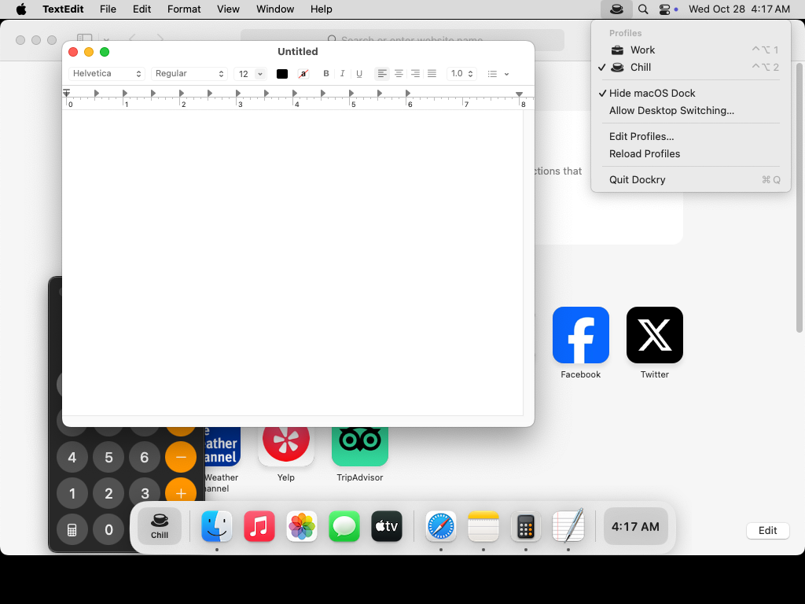

# Dockry

A dock for macOS that changes with what you're doing. Dockry runs next to the system Dock
(the way Raycast runs next to Spotlight) instead of modifying it. It can hide the system
Dock while it runs and gives it back when it quits.

| Work | Chill | Menu bar |
|---|---|---|
|  |  |  |

The screenshots are taken by CI on a GitHub-hosted macOS machine on every push to `dev`.

## What it does

- **A floating dock** at the bottom of the screen, on every desktop. It shows the active
  profile's pinned apps, then any other app that's running, then the profile's widgets.
  A dot marks running apps. Click to open or switch to an app. Right-click to keep it in or
  remove it from the profile, show it in Finder, or quit it.
- **Profiles** such as *Work* and *Chill*. Each has its own pinned apps, widgets (clock,
  date) and desktop. Activating a profile swaps the dock's contents and jumps to its desktop.
- **Switching profiles** with ⌃⌥1 … ⌃⌥9, from the menu bar item, or with the profile button
  at the left of the dock.
- **Hide macOS Dock** in the menu bar menu. This turns on the system Dock's auto-hide with a
  very long delay, so it never shows up. Your own Dock settings are saved first and put
  back when you turn the option off or quit Dockry.

## Building and running

Requires macOS 14 or later and Xcode 15 or later (or the Swift 5.9+ command line tools).

```bash
swift test              # unit tests for the platform-independent logic
scripts/bundle.sh       # builds build/Dockry.app
open build/Dockry.app
```

Don't run `scripts/screenshots.sh` on your own Mac. It's meant for CI: it opens and quits
apps and changes the Dock's settings.

### Permissions for desktop switching

macOS has no public API for desktops (Spaces), so Dockry presses the system's own
**Switch to Desktop N** shortcut for you. You need to do two things once, and the menu bar
menu tells you which one is still missing:

1. Turn on *Switch to Desktop 1, 2, …* in System Settings › Keyboard › Keyboard Shortcuts ›
   Mission Control. Each desktop must already exist in Mission Control.
2. Give Dockry Accessibility access in System Settings › Privacy & Security, so it can send
   the shortcut.

Profiles and the dock work without either of these.

### If the system Dock stays hidden

Dockry restores the Dock when it quits normally or receives `SIGTERM`. If it crashes,
reopening Dockry and turning off **Hide macOS Dock** restores it. Or run:

```bash
defaults delete com.apple.dock autohide-delay; killall Dock
```

## Profiles file

Profiles live in `~/Library/Application Support/Dockry/profiles.json`. **Edit Profiles…**
opens the file, and **Reload Profiles** applies your changes. Only `name` is required:

```json
{
  "activeProfileName": "Work",
  "profiles": [
    {
      "name": "Work",
      "symbol": "briefcase.fill",
      "desktop": 1,
      "pinnedApps": ["com.apple.Safari", "com.apple.mail"],
      "widgets": ["clock", "date"]
    }
  ]
}
```

- `symbol` is an [SF Symbol](https://developer.apple.com/sf-symbols/) name.
- `pinnedApps` are bundle identifiers. To find one, run `osascript -e 'id of app "Safari"'`.
- `desktop` can be 1 to 9. Leave it out to stay on the current desktop.

If the file can't be read, the menu says so and Dockry uses the default profiles without
saving over your file. Fix it and choose **Reload Profiles**. If you edit it in TextEdit,
turn off Edit › Substitutions › Smart Quotes first: curly quotes aren't valid JSON.

## Project layout

| Path | What's there |
|---|---|
| `Sources/DockryCore` | Profiles, the dock's layout rules, shortcut parsing. Plain Foundation, unit tested. |
| `Sources/Dockry` | The app: dock window and views, menu bar, hot keys, system Dock and desktop integration. |
| `App/Info.plist` | Bundle metadata used by `scripts/bundle.sh`. |
| `.github/workflows/macos.yml` | Builds, tests and takes the screenshots on a macOS runner. |
